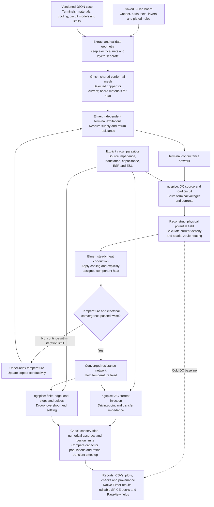

# PCB Power Integrity Lab

- **DC power delivery network (PDN):** supply and return voltage drops, differential load
  voltages, current distribution, effective resistance and copper loss.
- **AC power delivery network:** driving-point and transfer impedance,
  resonances, decoupling comparisons and target-impedance checks.
- **Load transients:** supply droop, overshoot and settling under finite-rise-time
  load steps and pulses, with comparisons between capacitor populations.
- **Steady electrothermal coupling:** copper heating, PCB temperature and
  temperature-dependent resistance, followed by AC and transient analysis at the
  converged temperature.

These are standalone CPU workflows.
Original software, documentation and synthetic fixtures are Apache-2.0.

KiCad supplies saved geometry; Gmsh meshes it; Elmer solves conduction and heat;
ngspice solves the attached circuit. Python checks conservation and produces
reports. ParaView opens the same voltage, current-density and temperature fields.
No hardware checkout or sibling lab source tree is required.

**Model boundary:** resistance is extracted from PCB geometry. Inductance,
effective capacitance, ESR, ESL and mounting parasitics are explicit circuit
inputs. This release does not extract broadband AC fields, model skin effect,
verify regulator control-loop stability, or predict device junction temperatures.
It has no CUDA execution path.

## How it works

The diagram follows `--analysis all`. A `dc` run stops after the cold electrical
solution; individual AC and transient runs first resolve the electrothermal
prerequisite. The board is read without modification or copper refilling.



Invalid inputs, failed solvers, failed conservation checks or electrothermal
nonconvergence stop the run. Solver completion, numerical validity and design-limit
compliance are reported separately. Mesh refinement is a separate verification
workflow; `verify` checks input, implementation and result hashes.

## Quick start

To view the example in KiCad 10, open
[board.kicad_pro](examples/synthetic-pdn/board.kicad_pro) in the project manager,
then double-click `board.kicad_pcb`. This is a PCB-only simulation fixture;
the source, loads and capacitor models are defined in `case.json` and the
generated SPICE decks. No schematic or external footprint libraries are required
to inspect the saved board.
The board is centered on landscape A4; its grid and auxiliary origins are at the
upper-left board corner. The [presentation update](docs/validation.md#board-presentation-update)
records its geometry equivalence to the original validation input and explains
the effect of cosmetic edits on file-hash verification.

Use Linux x86-64, Python 3.11+ and rootless Podman. The host requires no numerical
Python packages. The checkout launcher runs pinned numerical tools in a container.

```bash
./pcb-pi build
./pcb-pi doctor
./pcb-pi test --integration
./pcb-pi run examples/synthetic-pdn/case.json --analysis all
./pcb-pi verify examples/synthetic-pdn/case.json
```

`build` reuses the existing tools image identified in `env/runtime.json` and adds
the pinned ngspice package. Its upstream image is not required to have a local
source checkout. On a fresh machine, build independently:

```bash
./pcb-pi build --from-scratch
```

This downloads hash-verified assets and builds the lab's own base/tools recipes.
It can take hours and substantially more disk than the reused-image build. Keep
at least 20 GiB free. No image export or duplicate large download is needed for
the normal installed-image path. Tool sources and pins are under `env/`.

For an optional shell command from any directory, install this checkout editable:

```bash
python3 -m venv .venv
. .venv/bin/activate
python -m pip install -e .
pcb-pi doctor
```

Keep the checkout in place. Set `PCB_PI_ENGINE` to select a compatible container
engine, or `PCB_PI_IMAGE` to select an explicitly built image. The image's actual
identity enters every run's provenance and cache key.

## Analyses

```bash
./pcb-pi run examples/synthetic-pdn/case.json --analysis dc
./pcb-pi run examples/synthetic-pdn/case.json --analysis electrothermal
./pcb-pi run examples/synthetic-pdn/case.json --analysis ac
./pcb-pi run examples/synthetic-pdn/case.json --analysis transient
```

`all` computes a cold DC baseline, converges electrical/thermal feedback, then
runs both circuit analyses at the converged temperature. `ac` and `transient`
also resolve the electrothermal prerequisite; they do not silently use cold
resistance. Transients hold that thermal bias fixed. The final thermal solution
and the temperature used to calculate conductivity may differ by the recorded
convergence residual (less than the configured tolerance).

The default electrothermal iteration uses 0.5 relaxation, a 50-iteration limit,
temperature residual below 0.1 C, and electrical metric changes below 0.1% for
two consecutive iterations. Failed convergence or conservation stops the run.

The synthetic fixture has two copper layers, one source, two loads, a narrow
supply track, through vias, a return fill and two optional decoupling capacitors. Its materials,
cooling and parasitics are illustrative assumptions, not qualified hardware data.
See [case configuration](docs/cases.md) and [validation](docs/validation.md).

## Results and inspection

Results default to ignored `results/examples/synthetic-pdn/`:

- `report.md`, `checks.json`: separate solver completion, numerical validation
  and design-limit compliance. A failed design limit does not invalidate a solve.
- `dc/`, `electrothermal/`: conductance matrices, native Elmer inputs/meshes,
  full-precision fields, circuit decks, losses and thermal iteration history.
- `ac/`, `transient/`: editable ngspice decks, logs, impedance/voltage CSVs,
  population comparisons and transient timestep checks.
- `fields/`: VTU fields, `view.pvsm` and `open-view.py` for ParaView.
- `provenance.json`, `checkpoint.json`, stage manifests: source, implementation,
  image identity, completion and artifact hashes. Completed iterations can resume
  only when their input temperature and all other inputs match.

Open VTU files in ParaView, or load `view.pvsm` and relocate its `/output/fields`
data paths to your result directory. Running `open-view.py` with `pvpython`
recreates the state beside the fields. Circuit `.cir` files can be inspected
directly or loaded as SPICE netlists in Qucs-S; no editable Qucs schematic is
generated. All quantities are in SI units except explicitly suffixed mm/C values.

Mesh convergence is deliberately separate from hash verification:

```bash
python3 scripts/verify-convergence.py --scales 1 .25 .1875
```

This sequentially solves the synthetic case at three or more mesh sizes and checks
voltage drop, copper loss and temperature rise, then includes AC and transient
analysis on the accepted mesh. `results/refinement/summary.json` identifies that
mesh's output directory and report. The quick-start run is the coarse member of
this study. Do not infer numerical convergence
or hardware correlation merely from a completed solver run.
The explicit scales reproduce this fixture's release check. Omit `--scales` to
use the longer adaptive sequence when assessing a different case.

## Source preservation and licensing

Inputs are mounted read-only, and extraction never saves or refills a board.
Runs stop when available disk falls below the required reserve at launch.
`--force` replaces only the selected case's generated stage directories.
Nothing is published, pushed or committed by the CLI.

Third-party tools and input designs retain their own licenses. The reused code
and recipe attribution is in [NOTICE](NOTICE). This repository does not change
any upstream hardware design, report or provenance.
